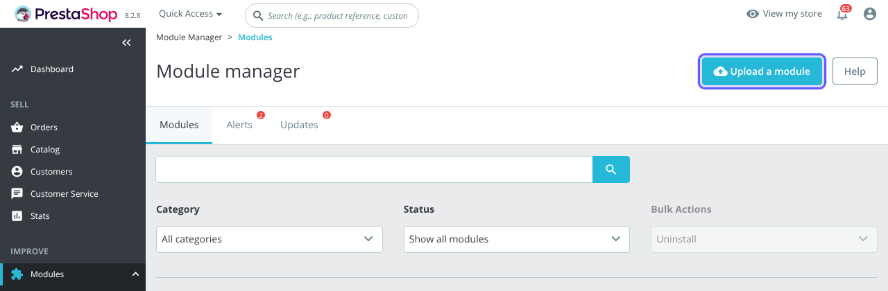
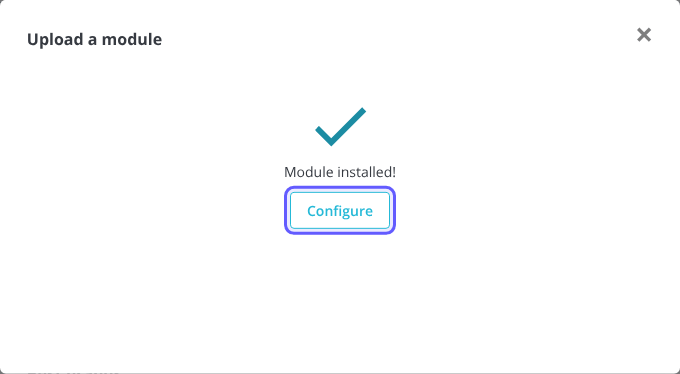
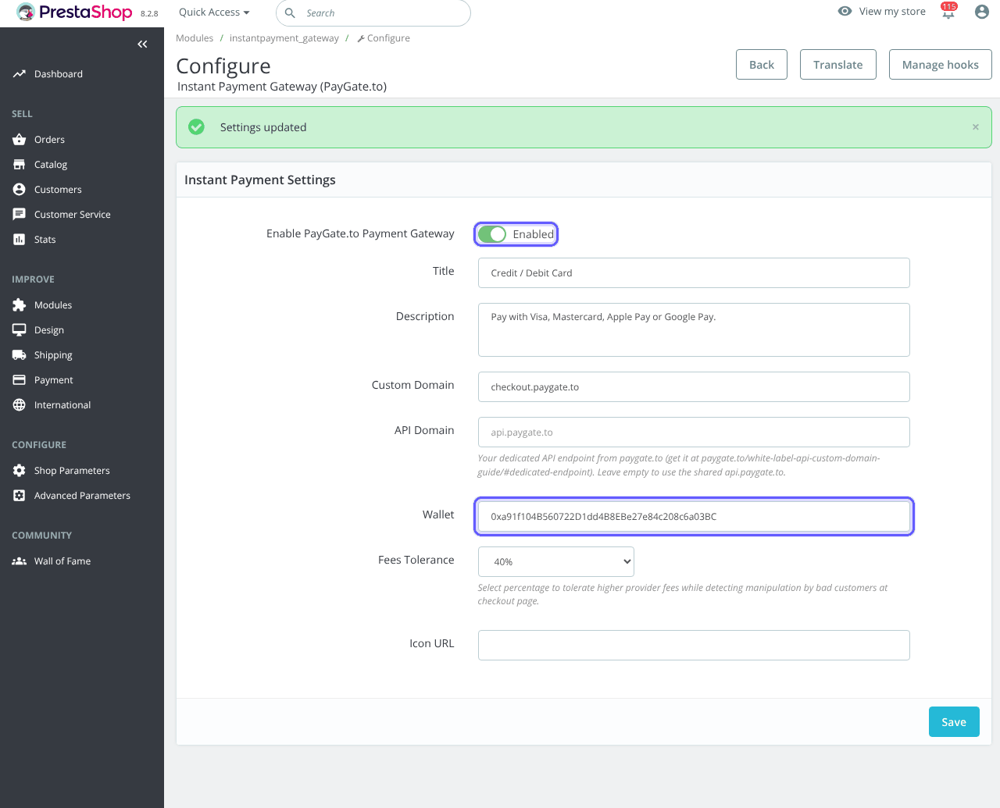
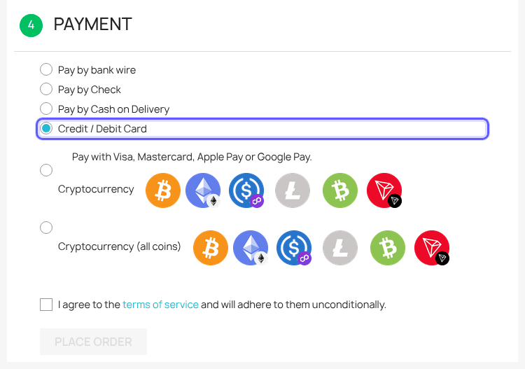
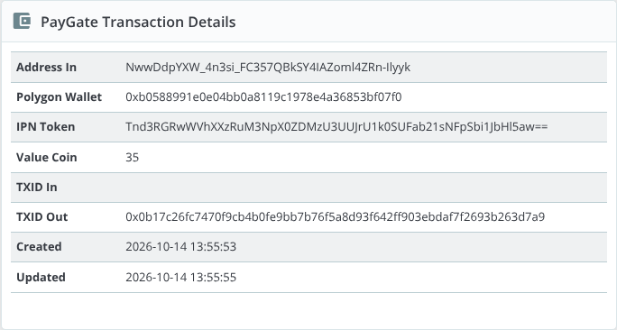

# PrestaShop-Instant-Payment-Gateway
Instant PrestaShop payment gateway to accept credit or debit cards or Google Pay or Apple Pay. Instant payouts to USDC wallet.

> 🪙 **Want crypto too?** Our free [PrestaShop crypto module](https://paygate.to/crypto-payment-gateway-no-kyc-instant-payouts/prestashop/) is the only crypto payment gateway with instant payouts for Solana, Monero, Zcash and Bitcoin.

## Features

- Accept **Visa, Mastercard, Apple Pay, Google Pay**, SEPA and local bank transfers.
- **Instant approval**: no sign up, no merchant account, no API keys and no KYC for you.
- **Instant payouts** to your own USDC (Polygon) wallet with every payment.
- **Zero chargebacks**: all payments are final.
- Multi-provider hosted payment page that picks the best provider for each customer's country.
- Payment confirmations signed by PayGate.to and verified by the module: orders are updated automatically.
- Works with your own checkout domain and a free dedicated API endpoint ([custom domain guide](https://paygate.to/white-label-api-custom-domain-guide/)).
- Fees: **1% + provider fees**.

📘 **Step-by-step guide with screenshots:** [https://paygate.to/instant-payment-gateway/prestashop/](https://paygate.to/instant-payment-gateway/prestashop/)

## Requirements

- **PrestaShop 1.7.7 or newer** (tested on PrestaShop 8.2)
- A public shop, not in maintenance mode while it takes card payments
- A USDC (Polygon) wallet address

## Installation

1. **Get your payout wallet.** Card payments are paid out to a **USDC wallet on Polygon** (an address that starts with `0x`). Payouts may arrive as USDC, USDT (Polygon or BEP-20), ETH or POL, and the same address receives all of them. Use a **self-custodial wallet** you control (Trust Wallet, MetaMask, Rabby, a hardware wallet). **Never use an exchange deposit address**, and never paste the USDC token contract address.
2. **Download** [instantpayment_gateway.zip](https://github.com/paygate-to/PrestaShop-Instant-Payment-Gateway/raw/refs/heads/main/instantpayment_gateway.zip) (do not unzip it).
3. **Modules › Module Manager › Upload a module**, drop the zip, then click **Configure**.

   

   

4. Enable the gateway, set the **Title**, paste your Polygon address into **Wallet**, check **Fees Tolerance** (40%) and click **Save**.

   

5. **Test**: the customer chooses the card option, accepts the terms and pays on the secure payment page.

   

6. When the payment is confirmed the order moves from **Awaiting card payment** to **Payment accepted**; below your Fees Tolerance it gets **Payment error**. The admin order page shows the **PayGate Transaction Details**.

   

## Settings

| Setting | Description | Default |
|---|---|---|
| Enable PayGate.to Payment Gateway | Shows the payment option. | Enabled |
| Title / Description | What customers see. | Instant Credit Card Payment / Pay using configured payment provider. |
| Custom Domain | Domain of the hosted payment page. | checkout.paygate.to |
| API Domain | Your dedicated API endpoint. | empty (uses api.paygate.to) |
| Wallet (required) | Your USDC (Polygon) payout address. | – |
| Fees Tolerance | How far below the total a payment may be before the order gets Payment error (10–90%, or disabled). | 40% |
| Icon URL | Logo next to the payment option. | empty |

Full product page: [https://paygate.to/instant-payment-gateway/](https://paygate.to/instant-payment-gateway/) · Support: [Telegram](https://t.me/PayGate_to)
